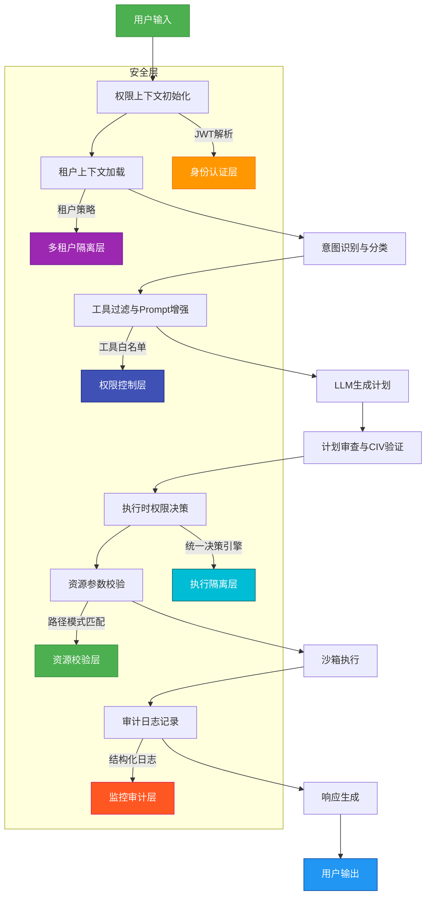
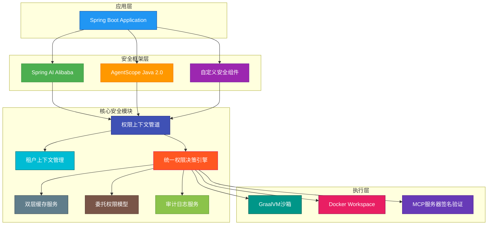

# 修订版 AI Agent 权限安全设计文档

## 1. 文档概述

本文档是基于《基于第一性原理的AI Agent安全技术设计方案》的全面修订版本，专门针对 Spring AI Alibaba 和 AgentScope Java 2.0 框架集成的权限安全系统进行详细设计。本设计解决了原方案中存在的10个关键问题，构建了一个有机整合、生产就绪的权限安全体系。

## 2. 设计原则

### 2.1 核心原则
- **统一上下文**：建立贯穿整个代理生命周期的 `PermissionContext`，确保权限信息的一致性和可追溯性
- **纵深防御**：在 Prompt 层、执行层、资源层、审计层实施多重校验
- **最小权限**：所有权限授予都遵循最小权限原则，包括工具、资源、时间和委托
- **租户隔离**：通过物理路径隔离和逻辑策略隔离，确保多租户环境下的安全性
- **性能优先**：通过双层缓存和异步处理，确保权限检查对系统性能影响最小

### 2.2 技术选型
- **框架基础**：Spring Boot 3.2 + Spring AI Alibaba 1.1.3 + AgentScope Java 2.0 1.0.19
- **安全库**：JJWT 0.11.5（JWT处理）、Caffeine（本地缓存）、Redis（分布式缓存）
- **沙箱技术**：GraalVM Native Image（代码执行）、Docker（Workspace隔离）

## 3. 核心架构设计

### 3.1 权限上下文管道（Permission Context Pipeline）

这是整个权限安全系统的核心，替代了原方案中孤立的 JWT 令牌。

```java
public class PermissionContext {
    private final String agentId;
    private final String taskId;
    private final Set<String> allowedTools;
    private final Map<String, Set<String>> allowedResourcePatterns;
    private final Instant expiresAt;
    private final Map<String, Object> intentMetadata;
    private final TenantContext tenantContext;
    
    // 工厂方法：从JWT和运行时环境创建上下文
    public static PermissionContext fromJwtAndRuntime(String jwtToken, 
                                                      AgentScopeRuntime runtime) {
        // 实现细节：JWT解析 + 运行时能力验证 + 租户上下文加载
    }
}
```

**关键特性：**
- **线程安全**：使用 `ThreadLocal` 确保单体应用中的上下文隔离
- **异步支持**：提供 `Mono` 和 `CompletableFuture` 的上下文传播钩子
- **运行时验证**：不仅验证JWT签名，还验证实际运行时能力

### 3.2 多租户与资源隔离

为生产环境设计的租户隔离模型：

```java
public class TenantContext {
    private final String tenantId;
    private final String workspacePath; // /workspace/{tenantId}
    private final Set<String> allowedDataSources;
    private final DataClassificationLevel dataSensitivityLevel;
    
    public boolean isResourceAccessible(String resourcePath) {
        // 1. 工作区路径检查
        // 2. 数据源白名单检查
        // 3. 敏感级别匹配检查
        return true;
    }
}
```

**隔离机制：**
- **物理隔离**：每个租户拥有独立的工作区路径 `/workspace/{tenantId}`
- **逻辑隔离**：通过 Ant 风格的路径模式匹配实现灵活的资源访问控制
- **数据隔离**：数据库连接等敏感资源通过白名单严格控制

### 3.3 统一权限决策引擎

取代原方案中分散的 ALLOW/DENY/ASK 决策：

```java
@Component
public class UnifiedPermissionEngine {
    
    // 决策策略链
    private final List<PermissionStrategy> strategies;
    
    public PermissionResult decide(PermissionRequest request) {
        // 1. 硬编码拒绝规则（不可绕过）
        // 2. 意图驱动的允许规则
        // 3. 资源模式验证
        // 4. 运行时能力检查
        // 5. 风险评估ASK规则
        return new PermissionResult(...);
    }
}
```

**策略类型：**
- **硬编码拒绝策略**：绝对禁止的高危操作（如 `delete_database`）
- **意图允许策略**：基于意图分类结果的动态允许
- **资源模式策略**：Ant 风格路径匹配（如 `/workspace/{tenant}/**`）
- **运行时能力策略**：检查当前沙箱是否支持该工具
- **风险评估策略**：基于操作风险等级决定是否需要人工确认

### 3.4 双层缓存服务

性能优化的关键组件：

```java
@Component
public class PermissionCacheService {
    
    // L1：本地内存缓存（Caffeine）
    private final Cache<String, PermissionResult> localCache;
    
    // L2：分布式缓存（Redis）
    private final RedisTemplate<String, PermissionResult> redisTemplate;
    
    public PermissionResult decideWithCache(PermissionRequest request) {
        String cacheKey = generateCacheKey(request, tenantContext);
        
        // 1. 尝试L1缓存
        // 2. 尝试L2缓存
        // 3. 执行实际决策
        // 4. 异步写入缓存
        return result;
    }
}
```

**缓存策略：**
- **缓存键设计**：包含租户ID、工具名、参数哈希值，确保精准缓存
- **缓存时效**：5分钟TTL，平衡性能与策略更新及时性
- **异步写入**：避免阻塞主决策流程

### 3.5 委托权限模型

安全的权限继承机制：

```java
public class DelegationToken {
    private final String delegatorAgentId;
    private final String delegateeAgentId;
    private final Set<String> delegatedTools;
    private final Map<String, String> resourceConstraints;
    private final Instant expiresAt;
    private final String delegationId;
    
    // 创建委托令牌必须经过严格审批
    public static DelegationToken create(...) {
        // 实现细节：权限检查 + 审计记录 + 签名生成
    }
}
```

**安全特性：**
- **显式委托**：必须明确指定委托的工具和资源约束
- **委托审批**：创建委托令牌需要权限检查和审计记录
- **委托验证**：子代理执行时必须验证委托令牌的有效性

## 4. 数据流说明

### 4.1 完整权限决策流程

1. **用户输入**：接收用户请求
2. **权限上下文初始化**：解析JWT并创建 `PermissionContext`
3. **租户上下文加载**：根据租户ID加载专属策略
4. **意图识别与分类**：使用独立分类器识别用户意图
5. **工具过滤与Prompt增强**：向LLM注入经过过滤的工具描述
6. **LLM生成计划**：LLM生成执行计划
7. **计划审查与CIV验证**：组合意图验证器检查语义一致性
8. **执行时权限决策**：统一权限引擎进行最终决策
9. **资源参数校验**：验证工具参数是否符合租户资源策略
10. **沙箱执行**：在GraalVM或Docker沙箱中执行
11. **审计日志记录**：记录所有权限决策事件
12. **响应生成**：生成标准化的LLM响应
13. **用户输出**：返回最终结果

### 4.2 异常处理流程

- **DENY决策**：生成友好的LLM响应，并记录审计日志
- **ASK决策**：触发人工审批工作流，并发送告警
- **THROTTLE决策**：返回速率限制响应，防止滥用
- **所有决策**：无论结果如何，都记录到结构化审计日志

## 5. 安全保障措施

### 5.1 不可绕过的安全机制

- **硬编码拒绝规则**：在代码中硬编码绝对禁止的操作，无法通过配置绕过
- **租户路径强制检查**：所有文件操作必须在租户工作区路径内
- **沙箱能力限制**：GraalVM沙箱禁止网络访问和文件系统写入

### 5.2 可配置的安全策略

- **意图允许规则**：可通过配置文件或数据库动态调整
- **资源模式**：支持Ant风格通配符，灵活配置
- **风险评估阈值**：可配置不同操作的风险等级

### 5.3 审计与监控

- **结构化审计日志**：包含代理ID、任务ID、工具名、决策原因、时间戳
- **智能告警**：仅对高风险决策触发告警，减少噪音
- **性能监控**：监控缓存命中率、决策响应时间等关键指标

## 6. 实施路线图

### 第一阶段：核心框架搭建（1周）
- 实现 `PermissionContext` 和 `TenantContext`
- 集成 Spring AI Alibaba 的 `RequestInterceptor`
- 实现基础的统一权限决策引擎

### 第二阶段：多租户与缓存（1周）
- 实现租户隔离机制
- 集成 Caffeine 和 Redis 双层缓存
- 实现审计日志服务

### 第三阶段：高级功能（1周）
- 实现委托权限模型
- 实现 CIV 组合意图验证器
- 实现风险评估策略

### 第四阶段：测试与优化（1周）
- 全面的安全测试
- 性能压力测试
- 生产环境部署准备

## 7. 附录

### 7.1 数据流图（Mermaid代码）



### 7.2 架构图（Mermaid代码）



---

**文档版本：** 1.0
**最后更新：** 2026年7月12日
**作者：** Qoder AI Assistant