# 🐈 nanobot 项目代码分析报告（v2 · 基于 v0.3.0 当前源码）

> **分析对象**：`F:\ai-agent\nanobot\nanobot`（Python 包，当前版本 **0.3.0**，git 标签 v0.1.4 → v0.3.0）
> **参考文档**：`PROJECT_ANALYSIS.md`（基于旧版 v0.1.4 的分析，已过时）
> **分析内容**：架构设计 / 功能描述 / 依赖图 / 代码设计优缺点（并与旧版逐项对照验证）
> **代码规模**：非测试 Python 约 **307 文件 / 9.5 万行**；测试约 **300+ 文件 / 3 万行**；另有 WebUI 前端（TypeScript ~251 个 src 文件、120+ 测试）

---

## 目录

- [一、项目概览与版本差异](#一项目概览与版本差异)
- [二、整体架构设计](#二整体架构设计)
- [三、各功能模块描述](#三各功能模块描述)
- [四、功能依赖图](#四功能依赖图)
- [五、代码设计优缺点分析](#五代码设计优缺点分析)
- [六、与旧版（v0.1.4）分析对照：19 条旧问题的处置结果](#六与旧版v014分析对照19条旧问题的处置结果)
- [七、综合评价与演进建议](#七综合评价与演进建议)

---

## 一、项目概览与版本差异

**nanobot** 是一个超轻量级、自托管的个人 AI Agent 框架（MIT，Python ≥3.11，依赖 `anthropic`/`openai`/`websockets` 等原生 SDK），v0.3.0 已从"多通道聊天机器人"演化为**"WebUI 优先 + 多通道 + 完整 Agent 能力"的运行时**：

| 维度 | v0.1.4（旧报告） | v0.3.0（本次） |
|---|---|---|
| 代码规模 | ~9,400 行 | **非测试 ~9.5 万行**（+前端/测试 ~30 万行量级） |
| 消息通道 | 9 个 | **17 个**（Telegram/Discord/Slack/Feishu/Matrix/WhatsApp/QQ/微信/企微/钉钉/MoChat/Teams/Email/Mattermost/NapCat/Signal/WebSocket） |
| LLM 接入 | LiteLLM 统一路由 + Custom + Codex | **LiteLLM 已移除**，改为原生 SDK 的 7 种 backend（openai_compat / anthropic / azure_openai / bedrock / openai_codex / xai_grok / github_copilot）+ FallbackProvider 故障切换 |
| 用户界面 | 无 | **WebUI（React SPA，经 WebSocket 多路复用协议）** + 原生 TUI（TypeScript）+ 经典 Python TUI |
| 网关 | 无 HTTP 服务（--port 是摆设） | **gateway 端口承载真实服务**：WS 多路复用 + 完整 HTTP 路由层 + /health |
| 记忆 | 双层文件记忆 | 三层（会话历史 + history.jsonl 游标 + Dream 定期整合，Git 版本化审计） |
| 自动化 | cron + heartbeat 独立服务 | **cron + heartbeat（系统 job）+ 本地触发器（triggers）+ 持续目标（goal）** |
| API | 无 | OpenAI 兼容 `/v1/chat/completions`（aiohttp）+ Python SDK（`Nanobot` 门面 + 流式事件） |
| 测试 | 6 个测试文件 | **300+ 测试文件**，coverage `fail_under = 75`，每通道自带测试 |
| 安全 | 少量守卫 | 独立 `security/` 模块：SSRF 三层防护、workspace 边界、配对审批、可选特性安装门控 |

**一句话**：旧报告描述的"3,700 行核心"已不复存在——项目在保持"研究友好、无重量级框架"气质的同时，长成了一个**具备生产级工程密度**的多面体。本报告在旧版五节结构上重写，并新增"旧问题处置对照表"。

---

## 二、整体架构设计

### 2.1 分层架构

```
┌──────────────────────────────────────────────────────────────────────────┐
│ 入口/交互层   cli/（entry 快路径 + commands 组合根 + TUI launcher）          │
│               nanobot.py Nanobot 门面（Python SDK）  webui/src（React SPA） │
├──────────────────────────────────────────────────────────────────────────┤
│ 通道层        channels/registry.py（pkgutil 插件发现）                     │
│               channels/manager.py（装配/热启停/外发分发）                   │
│               17 个自包含通道包（manifest.py 声明 + runtime.py 实现）        │
│               channels/websocket/*（网关的 WS+HTTP 服务端，含 webui/ 处理层）│
├──────────────────────────────────────────────────────────────────────────┤
│ 总线/事件层   bus/queue.py MessageBus（inbound/outbound 双队列）            │
│               bus/runtime_events.py RuntimeEventBus（进程内 pub/sub）       │
│               bus/outbound_events.py 类型化 OutboundEvent（进度/流式/回执）  │
├──────────────────────────────────────────────────────────────────────────┤
│ Agent 核心层  agent/loop.py AgentLoop（7 阶段 turn 流水线 + 调度 + 持久化）  │
│               agent/runner.py AgentRunner（共享 LLM⇄工具执行循环）           │
│               agent/context.py ContextBuilder（system prompt 组装）         │
│               agent/memory.py MemoryStore + Consolidator（三层记忆/Dream）  │
│               agent/subagent.py SubagentManager（复用 AgentRunner）         │
│               agent/hook.py + progress_hook.py + turn_delivery.py（钩子/投递）│
│               agent/tools/*（22 内置工具 + MCP + 注册表 + 校验）             │
│               agent/skills.py + skills/（11 内置技能，三级渐进加载）         │
├──────────────────────────────────────────────────────────────────────────┤
│ 模型层        providers/registry.py（ProviderSpec 数据表）                  │
│               providers/base.py（LLMProvider + 统一重试 + 流式回调）         │
│               providers/*（7 backend + fallback + 图像生成 11 实现 + 转写 6 适配）│
│               audio/（转写编排：注册表 + 配置解析 + 入口）                   │
├──────────────────────────────────────────────────────────────────────────┤
│ 设施层        config/（pydantic 树 + 加载/迁移/错误脱敏 + watcher）          │
│               session/（Session + JSONL 原子存储 + goal_state + webui 投影） │
│               cron/  triggers/  command/  pairing/  security/  utils/      │
│               gateway/（后台进程托管 + systemd/launchd 服务安装）            │
└──────────────────────────────────────────────────────────────────────────┘
```

### 2.2 核心设计模式（v0.3.0）

| 模式 | 落地位置 | 说明 |
|---|---|---|
| **门面（Facade）** | `nanobot/nanobot.py` `Nanobot` | 对外只暴露 `run / run_streamed / stream / sessions / memory / runtime`，内部组装 AgentLoop+MCPProvider+SDK clients |
| **插件注册表（两套）** | `channels/registry.py` + `channels/plugin.py`；`agent/tools/loader.py`（pkgutil + entry-points）；`providers/registry.py` | 通道是"自包含包 + manifest.py 声明"；工具是"pkgutil 扫描 + `nanobot.tools` entry-points"；provider 是"数据表"。三处扩展点均不再需要改核心装配代码 |
| **阶段机流水线** | `AgentLoop._process_message`（restore→compact→command→build→run→save→respond 七阶段，`_run_turn_stage` 统一计时） | 取代旧版"一个函数干到底"，每阶段可独立测试 |
| **模板方法 + 钩子** | `AgentHook`（17 个空实现钩子）+ `CompositeHook`；`TurnDelivery` 生命周期 | runner 不关心"投递到哪里"，channel 与 SDK 各取所需 |
| **不可变值对象** | `LLMRuntime`（frozen，准入后禁止查 provider 可变状态）、`RequestContext`、`StreamEvent/RunResult` | 消除回合中配置漂移与请求上下文共享 |
| **ContextVar 请求作用域** | `RequestContext`、`FileStates`、`WorkspaceScope` | 并发会话的工具状态互不污染（工具实例是共享的） |
| **组合根** | `cli/gateway_runtime.py::_run_gateway` | 唯一装配点：bus/runtime_events/provider/session/cron/trigger/agent/channels/webui 全在此接线；`create_gateway_app` 工厂注入依赖供测试 |
| **错误即值（error-as-value）** | `LLMResponse(finish_reason="error")` + 结构化错误元数据；`ToolResult.error` | 重试/分类集中在基类 `_run_with_retry`；工具错误以字符串喂回模型 |
| **WAL 式操作日志** | `cron/service.py` 的 `action.jsonl` | 多进程协同修改 jobs.json，防旧快照重放已执行任务 |
| **门控/熔断** | `FallbackProvider`（主 provider 3 次失败熔断 60s）、Responses API 熔断（3 次/5 分钟）、`NANOBOT_MAX_CONCURRENT_REQUESTS` 并发门 | |

### 2.3 运行时数据流

```
[用户消息] ─▶ 通道 SDK 回调 ─▶ BaseChannel._handle_message（鉴权/配对→事件）
   ─▶ MessageBus.inbound ─▶ AgentLoop.run()（唯一消费者，1s 超时轮询）
        ├─ handle_runtime_control（会话丢弃/图生成重载）→ 短路
        ├─ 优先级命令（/stop 等）→ _dispatch_command_inline（锁外）
        ├─ automation 协调器 defer（cron/trigger 会话忙时排队）
        ├─ 忙会话消息 → 该会话 pending 队列（mid-turn 注入）
        └─ asyncio.create_task(_dispatch(msg))  # 跨会话并发
            └─ per-session 锁 + 全局并发门
               └─ _process_message 7 阶段
                    ├─ restore：取/建 Session，恢复检查点
                    ├─ compact：TTL/预算预压缩
                    ├─ command：斜杠命令短路
                    ├─ build：runtime 解析 → token 预压缩 → 历史 → provider_state 续接 → ContextBuilder.build_messages
                    ├─ run：_run_agent_loop → AgentRunner.run(AgentRunSpec)
                    │      └─ 多轮迭代：ContextGovernor 治理 → 流式请求 → 工具分批并发执行
                    │           → 注入（用户续话/子代理结果）→ 检查点 → 长度恢复 → 空响应重试
                    ├─ save：_save_turn 清洗/去重/截断 → 后台再压缩 → SessionTurnPersisted
                    └─ respond：MessageTool 抑制 → OutboundMessage（带 OutboundEvent）
   ─▶ MessageBus.outbound ─▶ ChannelManager._dispatch_outbound（delta 合并/重试/去重）
   ─▶ channel.send / send_delta / send_reasoning_* ─▶ 用户

旁路1：子代理 SpawnTool → SubagentManager（复用 AgentRunner，独立上下文+受限工具）
        → 完成后构造 channel="system" 的 InboundMessage 回注总线 → 主 agent 以 SYSTEM turn 消费
旁路2：CronService / LocalTriggerStore → 构造 InboundMessage（sender_id=cron|trigger）
        → submit_cron_turn / 入队 → 与用户消息同流水线（会话忙则 defer）
旁路3：heartbeat / dream 作为 cron 系统 job → gateway_runtime.on_cron_job → process_direct
旁路4：SDK/API/CLI 直连 → AgentLoop.process_direct（与总线 turn 共享会话锁）
旁路5：WebUI 不经总线队列：WebuiTurnCoordinator 订阅 RuntimeEventBus 投影 turn 生命周期为 WS 帧
```

### 2.4 三条"总线"的职责分离（重要设计）

| 机制 | 位置 | 语义 | 消费者 |
|---|---|---|---|
| `MessageBus` | `bus/queue.py` | 点对点队列对（inbound/outbound），**无广播** | inbound 唯一消费者是 `AgentLoop.run()`；outbound 消费者是 `ChannelManager._dispatch_outbound`（gateway）/ CLI 交互模式 |
| `RuntimeEventBus` | `bus/runtime_events.py` | 进程内 pub/sub（turn 生命周期/模型切换/goal 状态），8 种事件工厂 | `WebuiTurnCoordinator`（→WS 帧）、WebUI 适配器、fallback 观察者 |
| `OutboundEvent` 类型层 | `bus/outbound_events.py` | 挂在 `OutboundMessage.event` 上的类型化语义（Progress/StreamDelta/StreamEnd/RetryWait/RuntimeModelUpdated/StreamedResponse…） | ChannelManager 分发、CLI 渲染 |

---

## 三、各功能模块描述

### 3.1 总线层（`bus/`，6 文件，643 行）

- **`queue.py`**：`MessageBus` 仅含 inbound/outbound 两个 `asyncio.Queue` + qsize 统计。**旧版的 `subscribe_outbound/dispatch_outbound` 死代码已被删除**，外发语义由类型化事件 + 单消费者承担。
- **`events.py`**：`InboundMessage`（新增 `session_key_override`/`require_existing_session`/`input_role` 字段，支持线程级会话与显式 user/system 角色；`metadata` 保留 `_runtime_control`/`_user_shell` 等内部键并注明"不可信客户端不得伪造"）+ `OutboundMessage`（新增 `buttons`/`event` 字段）。
- **`runtime_events.py`**（10.4KB）：`RuntimeEventBus` 进程内发布/订阅 + `RuntimeEventPublisher`（`user_input_accepted`/`session_turn_started`/`turn_runtime_admitted`/`run_status_changed`/`session_turn_persisted`/`turn_completed`/`runtime_model_changed`）。
- **`outbound_events.py`**（8.1KB）：OutboundEvent 类型族 + `outbound_event_from_message`（优先 event，回退 `_legacy_event_from_metadata` 兼容旧 metadata 旗标）+ `replace_outbound_event`。

### 3.2 通道层（`channels/`，17 个通道 + 管理/契约，77 文件 / 2.3 万行）

- **`base.py`（341 行）**：`BaseChannel` 生命周期 `start/stop/send` + **流式原语** `send_delta/send_reasoning_delta/send_reasoning_end` + 扩展钩子 `progress_transport_defaults/should_retry_send_error/start_error_message` + `transcribe_audio` + `login`。**配对（pairing）已内建进基类**（`is_approved`/配对码回复）。`_handle_message` 模板方法统一做鉴权→构造事件→入队。
- **`plugin.py` + `registry.py` + `contracts.py`**：通道插件化核心——每个通道包声明 `manifest.py` 暴露 `ChannelPlugin`（name/display_name/runtime="module:Class"/setup 表单描述/dependencies 依赖声明/default_enabled/capabilities/webui 入口），**发现阶段只读 manifest 不导入运行时 SDK**；`discover_plugins()` 用 `pkgutil.iter_modules` 扫描。这是旧版"新增通道要改 4 处"问题的**正面回答**：加通道 = 新建一个自包含包。
- **`manager.py`（1017 行）**：装配（逐插件激活→依赖检查→懒加载类→多实例 runtime_name 冲突检测）、热启停（`apply_channel_feature_action` 支持 WebUI 不重启启停通道）、外发分发（**流式 delta 合并**、指数退避重试、指纹去重、reasoning 独立通道、RetryWait 丢弃、RuntimeModelUpdated 直通）、`get_status` 运行态上报。
- **17 个通道实现**（均为 `runtime.py`，行数含测试外的实现）：

| 通道 | 实现行数 | 接入方式与特点 |
|---|---|---|
| **WebSocket/WebUI** | 1993 | websockets 库；**同一端口承载 WS 多路复用协议 + 全部 HTTP 路由**（bootstrap/sessions/settings/media/静态文件）；信封类型 11 种；`webui_request` 即 WS 上的异步 mutation RPC（request_id 去重/重放）；token 认证 + 受信代理 CIDR |
| **Telegram** | 1727 | python-telegram-bot 长轮询；语音转写、Markdown→HTML、4000 字符分片、typing 指示器、`id\|username` 复合 ID 鉴权 |
| **Feishu** | 2513 | lark-oapi WebSocket 长连接 + 事件加密/验证；最完整的通道（卡片流式） |
| **WeChat（weixin）** | 2354 | 自建协议（非官方 web 协议，需扫码）；QR 登录会话 + 重连状态机 |
| **Signal** | 1213 | 自有协议实现；`_handle_message` 直发 bus，`_send_http_request` 吞异常 |
| **Matrix** | 1071 | Matrix SDK 同步回调 + asyncio 桥接 |
| **MoChat** | 848 | socket.io 客户端；回复延迟合并缓冲、提及策略（**唯一无测试的通道**） |
| **Email** | 803 | IMAP 轮询（to_thread 包同步 imaplib）+ SMTP 回复；`consent_granted` 授权闸门；UID 去重；线程引用 |
| **DingTalk** | 794 | dingtalk-stream SDK + 内置 CallbackHandler |
| **Slack** | 752 | Socket Mode；DM 策略、thread 回复（`metadata.thread_ts`）、slackify 渲染 |
| **Mattermost** | 664 | WebSocket + 忽略系统消息 |
| **QQ** | 654 | qq-botpy SDK + 重连退避 |
| **Discord** | 725 | 原生 WebSocket 网关（零 SDK）+ 不完整事件重连 |
| **WhatsApp** | 688 | WebSocket 桥接 Node.js Baileys；断线重连；pn/LID 双发送方格式 |
| **NapCat** | 517 | OneBot v11（NapCatQQ）；echo 关联、图片下载 |
| **MS Teams** | 724 | Bot Framework + 卡片 |
| **WeCom** | 481 | 企微 SDK；引用私有 API |

**通道能力矩阵（实测）**：流式 `send_delta` 重写仅 **7 个通道**（telegram/discord/feishu/matrix/weixin/websocket/mattermost 伪流式）；reasoning 流与 file_edit 事件**只有 websocket 实现**；`transcribe_audio` 仅 telegram/feishu/matrix/whatsapp/weixin 使用；`login`（QR）仅 feishu/whatsapp/weixin。**死配置**：mattermost 的 `streaming/send_progress/send_tool_hints`、websocket 的 `streaming/token_ttl_s`、discord 的 `streaming`、slack 的 `webhook_path`、feishu 的 `config.streaming` 均声明但未被实现消费。**manifest 疏漏**：signal/mattermost 未声明 `dependencies`（需手动装依赖，`optional_features` 无法自动安装）。

### 3.3 Agent 核心（`agent/`，非 tools 部分 49 文件 / 1.9 万行）

- **`loop.py`（2419 行）`AgentLoop`**——仍是"上帝对象"，但职责结构化了：
  - **调度**：`run()` 唯一 inbound 消费者；`_dispatch()` per-session `asyncio.Lock`（WeakValueDictionary 缓存）+ 全局 `Semaphore`（`NANOBOT_MAX_CONCURRENT_REQUESTS`，默认 3）；忙会话消息进 `_pending_queues` 做 **mid-turn 注入**，结束后残留消息重投总线。
  - **7 阶段流水线** `_process_message`：restore / compact / command / build / run / save / respond（见 2.3）。
  - **持久化与恢复**：`_save_turn`（tool_call 去重、超长截断、图片占位、latency 元数据）、`_set/_restore_runtime_checkpoint`（中断现场恢复）、`_restore_pending_user_turn`。
  - **协调器**：`CronTurnCoordinator`/`LocalTriggerTurnCoordinator`（automation turn 的 defer/等待）、`AutoCompact`（TTL 空闲压缩）、`Consolidator`（token 预算归档）、`SubagentManager`、`CommandRouter`。
  - **运行时选择**：`runtime_for_session`/`set_model_preset`/`set_runtime_model`/`refresh_runtime_config`（配置热刷新，供 WebUI 切模型）。
- **`runner.py`（1710 行）`AgentRunner`**——**共享执行循环**：`run(AgentRunSpec) → AgentRunResult`，主 agent 与子代理**共用**（旧版"子代理复制主循环"问题已解决）。`_run_core` 是 ~450 行巨方法：迭代 = ContextGovernor 治理 → `_request_model`（流式/进度/非流式三路）→ reasoning 流式推送 → 工具分批并发（`_partition_tool_batches` 按 `concurrency_safe`）→ 检查点 → 注入 drain（用户续话/子代理结果，保序）→ 空响应重试（≤2）→ 长度恢复（≤3 段 `resuming=True`）→ max_iterations 收尾（finalize 重试 + 模板 fallback）。
- **`context.py` `ContextBuilder`**：system prompt = identity + 5 bootstrap 文件 + 长期记忆（Recent History 游标段）+ always 技能全文 + 技能摘要 + `runtime_context` 块（模型专属上下文，`append_runtime_context` 附加/剥离/重挂，保证"用户可见历史"与"模型输入"分离）。
- **`memory.py`（1,300+ 行）**：`MemoryStore`（MEMORY.md + **history.jsonl 游标追加** + legacy HISTORY.md 迁移 + Dream 游标）+ `Consolidator`（token 预算驱动归档：`maybe_consolidate_by_tokens` 同步/BUILD 阶段 + SAVE 后后台 + TTL 空闲三触发点）+ **Dream 两阶段整合**（cron 系统 job → 受限工具集跑 LLM → 游标推进 → **dulwich Git 提交审计**）。
- **`subagent.py`（600+ 行）**：`SubagentManager`——`spawn`/`run_inline` 均走 `self.runner.run(AgentRunSpec)`，独立 `ToolRegistry`（scope="subagent" 受限工具），结果经总线以 `channel="system", sender_id="subagent"` 回注；并发上限、状态表（供 my 工具/WebUI）。
- **`hook.py` + `progress_hook.py` + `turn_delivery.py`**：AgentHook 生命周期（before_run/on_error/after_run/on_finally/before_iteration/on_stream/…17 个钩子）、`AgentProgressHook`（runner 事件→用户可见进度/工具提示/reasoning）、`TurnDelivery`（started/running/complete/fail/idle + 流式增量 + retry_wait，与执行逻辑分离）、`TurnDeliveryFactory`（可注入 `route_policy`）。
- **`context_governance.py` `ContextGovernor`**：不污染持久化消息的前提下，修复/压缩模型输入（normalize tool result、strip 畸形 tool call、drop 孤儿 tool result、backfill 缺失 tool result、inflight 溢出压缩、history snip）。
- **`autocompact.py` / `model_runtime.py` / `model_presets.py` / `turn_hooks.py` / `automation_turns.py` / `cron_turns.py`**：TTL 压缩、`ModelRuntimeResolver`（模型选择独立服务，`admit/refresh/resolve_preset/select_*`）、preset 目录、turn 钩子工厂、自动化回合协调。

### 3.4 工具系统（`agent/tools/`，28 文件 / 1.06 万行）

- **机制**：`Tool` ABC（`read_only/exclusive/concurrency_safe`、`config_cls`/`enabled`/`create` 生命周期）+ `tool_parameters` 装饰器注入 JSON Schema + 自研校验器（type/enum/min/max/长度/required/additionalProperties/items，**不支持 pattern/format/oneOf**）+ `ToolRegistry`（参数 JSON 解包/强转/校验/执行兜底 + 定义缓存）+ `ToolLoader`（pkgutil 扫描 + `nanobot.tools` entry-points 插件，`_SKIP_MODULES` 手工跳过表）+ `RequestContext`/`FileStates`/`WorkspaceScope` 经 **ContextVar** 注入。
- **22 个内置工具**：

| 组 | 工具 | 要点 |
|---|---|---|
| 文件 | `read_file`/`write_file`/`edit_file`/`list_dir`/`apply_patch` | 读写目录分离、symlink 解析、设备路径黑名单、四级模糊匹配编辑、apply_patch 全量回滚、文件 cap 归档 |
| Shell | `exec`/`write_stdin`/`list_exec_sessions`/`run_cli_app` | deny 黑名单 + allow 白名单优先 + workspace 路径守卫 + 内网 URL 检测 + 环境最小化 + 进程树清理（Unix killpg / **Windows Job Object**）+ 长运行 exec 会话（有界缓冲、按 owner 隔离） |
| Web | `web_search`（13 家 provider，缺 key 降级 DDG）/`web_fetch` | SSRF 三层防护（URL 校验 + 固定 DNS `PinnedDNSAsyncTransport` + 逐跳重定向）、凭据 URL 转发防护、readability 抽取 |
| 搜索 | `find_files`/`grep` | 二进制检测、大小上限、截断 |
| 调度 | `cron` | every/cron/at 三模式 + 时区；系统 job 保护；回调内禁建 job |
| 图像 | `generate_image` | 多 provider（含异步任务轮询）、热重载、SSRF 防护 |
| 消息/会话 | `message`/`search_sessions`/`read_session`/`list_sessions`/`send_session_message` | 主动发消息（路由注入）、跨会话消息 + 源会话限流（6 条/分钟）+ expect_reply |
| 子代理/目标 | `spawn`/`create_goal`/`update_goal` | 并发上限；持续目标（goal_state 元数据 + 权限门 + 每轮 prompt 注入 + 续跑 12 轮） |
| 自省 | `my` | 运行时自检/自改：BLOCKED/READ_ONLY/DENIED/SENSITIVE 四层黑名单 + 类型/范围校验 + scratchpad 安全 JSON |
| MCP | （见下） | |

- **MCP（`mcp.py` 1707 行 + `mcp_oauth.py`）**：stdio/SSE/streamable HTTP 三传输；`mcp_{server}_{tool}` 命名（超 64 字符 sha1 截断）；schema 归一化（$ref→$defs、nullable 联合）；逐请求 SSRF 校验；`enabledTools` 白名单；瞬时错误重试 + 断线重连 + 连接所有权（`_OwnedMCPConnection`）；OAuth 存储 0600 + 写租约；`MCPProvider` 热重载（签名比对）。
- **技能系统（`skills.py` + `skills/` 11 个内置技能）**：frontmatter 解析（`metadata.nanobot`/`openclaw` 兼容键）、`requires.bins/env` 检查、workspace > 插件 > 内置三级遮蔽、**三级渐进加载**（摘要常驻 → `$skill-name` 触发正文 → 按需读 references）、always 技能全量注入。

### 3.5 模型层（`providers/` 25 文件 + `audio/` 3 文件 + `api/` 3 文件）

- **`base.py`（1,300+ 行）`LLMProvider`**：抽象 `chat()`/`get_default_model()`；`chat_stream()` 默认实现 = 非流式 + 单 delta；延续性钩子（`can_resume_conversation_state`/`supports_native_compaction`/`chat_with_context`，Responses 系 provider 覆写）；**统一重试引擎** `_run_with_retry`（429 语义分类、Retry-After 解析三件套、图片剥离重试、persistent 模式、流式已出内容超时恢复）；消息卫生（空内容清洗、UTF-16 代理项清理、role 交替修复）；流式空闲超时 `NANOBOT_STREAM_IDLE_TIMEOUT_S`（默认 90s）。
- **`registry.py`（800+ 行）`ProviderSpec` 数据表**：~50 个 provider 的 keywords/env/探测/参数覆盖/thinking 风格全部数据化；`Config._match_provider` 按注册表顺序做 7 级匹配（显式前缀→模型前缀→自定义前缀→关键字→本地探测→网关回退→自定义兜底）；**加 provider 核心只需 2 处改动**（PROVIDERS 表 + ProvidersConfig 字段）。
- **7 种 backend + Fallback**：`OpenAICompatProvider`（89KB 主力，Chat Completions/Responses 双 API 自动路由 + 熔断 + langfuse 包装 + 本地端点 keepalive/代理处理）、`AnthropicProvider`（thinking 预算/adaptive、tool id 消毒、消息转换）、`AzureOpenAIProvider`（纯 Responses + AAD 双认证）、`BedrockProvider`（Converse API + to_thread 桥接）、`OpenAICodexProvider`（OAuth + SSE + 原生压缩 + prompt_cache_key）、`XAIGrokProvider`（OAuth+PKCE + hosted X Search 能力门控）、`GitHubCopilotProvider`（device flow + 短时 token 刷新）、`FallbackProvider`（认证类错误 failover、主 provider 熔断、流式已出内容不切换）、`UnconfiguredProvider`（首次设置占位）。
- **图像生成（`image_generation.py` 2,129 行）**：11 个实现（OpenRouter/AIHubMix/Ollama/Gemini/MiniMax/OpenAI/Codex/StepFun/Zhipu/ModelScope/Custom），下载 32MiB 上限 + 重定向限制 + 非代理时固定 DNS 防 SSRF。
- **转写（`transcription.py` 828 行 + `audio/`）**：6 个适配器（Groq/OpenAI/OpenRouter/MiMo/StepFun/AssemblyAI），统一 3 次退避重试，失败静默空串；`audio/` 分层（app 层配置/校验/编排 vs provider 层 HTTP）。
- **API server（`api/server.py` 505 行）**：`/v1/chat/completions`（JSON/multipart，单条 user 消息，图片仅 data URL）+ `/v1/models` + `/health`；HMAC 常量时间比较鉴权；每会话锁串行化；经 `AgentLoop.process_direct` 复用完整 agent；SSE 流式；`api/runtime.py` 让 WebUI 以受管子进程管理它。

### 3.6 配置与会话（`config/` 7 文件 + `session/` 11 文件）

- **`schema.py`（717 行）**：pydantic-settings 树（agents/channels/transcription/providers/api/gateway/tools/model_presets），camelCase 别名（`config_base.py` alias_generator + AliasChoices 兼容历史键）、`NANOBOT_` env 前缀 + `__` 嵌套分隔、`extra="allow"`、lazy 工具配置类型避免导入环、敏感字段 `repr=False`。
- **`loader.py`**：加载/迁移（`tools.exec.restrictToWorkspace → tools.restrictToWorkspace` 等）、`${VAR}` 环境引用（**同一语法两种失败语义**：缺变量抛错 vs 返回空串）、`ConfigLoadError` 分级 + **错误脱敏**（`include_input=False` + key 白名单，防凭据泄漏）、`watcher.py` watchfiles 热监听。
- **`session/manager.py`（1,878 行）**：`Session`（key/messages/metadata/provider_state/policy）+ `JsonlSessionStore`（**base64url 无碰撞文件名**、原子写 + fsync、workspace-id 命名空间防 symlink、损坏逐行修复、快照迁移）+ `SessionManager`（LRU 缓存、delete 观察者、fork 支持、`flush_all` 关停落盘）。`get_history` 双预算切片 + think 清理 + 媒体面包屑。
- **`session/goal_state.py`**：持续目标元数据（status/objective/ui_summary）+ `runner_wall_llm_timeout_s`（目标回合**禁用 LLM 墙钟超时**）+ 续跑轮数。
- **`session/webui_turns.py`**：WebUI 标题 LLM 生成、`WebuiTurnCoordinator`（RuntimeEventBus→WS 帧）、**模块级进程全局 turn 投影字典**（重启即失）。

### 3.7 调度与自动化（`cron/`、`triggers/`、`agent/long_task.py`）

- **`cron/service.py`（700+ 行）**：at/every/cron（croniter + zoneinfo）三调度；`asyncio.sleep` 单定时器（最长休眠 5 分钟）；jobs.json 原子写 + **action.jsonl 操作日志（WAL）+ `_store_dirty` 防重放**；系统 job（dream/heartbeat）受保护；运行历史截断 20 条；`on_job` 回调注入。
- **`triggers/local_store.py` + `local_runner.py`**：CLI `nanobot trigger <id> "msg"` 投递会话绑定消息；inbox/processing/failed/runs 目录 + FileLock + 原子写；崩溃遗留 processing 恢复；最多 10 次投递；`LocalTriggerTurnCoordinator` 会话忙时 defer。
- **heartbeat**：不再是独立服务，是 cron 系统 job——读 `HEARTBEAT.md`，有活跃任务才跑 agent 回合，LLM 裁决（fail-closed）是否打扰用户。
- **持续目标**：`create_goal`/`update_goal` 工具 + `/goal` 命令授权门 + 每轮 prompt 注入 + 续跑 12 轮（`_MAX_GOAL_CONTINUATION_ROUNDS`）。

### 3.8 命令 / 配对 / 安全（`command/`、`pairing/`、`security/`）

- **`command/router.py` + `builtin.py`（1,068 行）**：三级路由（priority 锁外 / exact / 最长前缀）；`/cmd@bot` 后缀剥离；`CommandLifecycle` 枚举（side_channel/finalize_active_turn/stop_active_turn/agent_turn…）是 **WebUI 协议契约**；17 个内置命令（stop/restart/status/new/model/goal/dream/history/skill/pairing/trigger/`__shell`…）；difflib 相近命令建议。
- **`pairing/store.py`**：DM 未授权发送者 → 8 位配对码（TTL 600s）→ WebUI/`/pairing` 审批；`is_approved` **fail-closed**（读失败=拒绝）；写失败响亮失败不覆写。
- **`security/`**：`network.py`（SSRF：RFC1918/环回/云元数据阻断、IPv6-mapped 归一化、`PinnedDNSAsyncTransport` 钉住已校验 IP、ssrf_whitelist CIDR）；`workspace_access.py`（WorkspaceScope + ContextVar + 沙箱状态探测）；`workspace_policy.py`（路径边界 + 面向 LLM 的 `WORKSPACE_BOUNDARY_NOTE` 提示注入防御）。**注意：AGENTS.md 声称的 "PTH file guard" 在当前代码树中不存在（文档残留）。**

### 3.9 网关与 WebUI（`gateway/`、`channels/websocket/`、`webui/`、`webui/src`）

- **`gateway/runtime.py`（652 行）**：后台/前台/按需三模式进程托管（`ManagedProcessRuntime`：PID 身份校验、state 文件原子写、Windows PID 交接）、`GatewayClientLease` 客户端引用计数租约（最后客户端退出即停）、`GatewayServiceInstaller`（systemd user unit / launchd plist）。
- **`channels/websocket/runtime.py`（2,125 行）**：**一条 WS 连接承载 N 个聊天**；订阅簿记 `_subs/_conn_chats`；信封 11 种；`webui_request` 异步 mutation RPC（request_id 去重/重放 + 5 分钟结果缓存）；同一端口 HTTP 分流（`websockets.process_request`）；token/bootstrap 短时令牌/受信代理 CIDR 认证；出站 20+ 事件类型；事件同时写规范转录（`webui/transcript.py`）。
- **`webui/`（42 文件 / 1.57 万行）**：HTTP 路由层（`ws_http.py` 1,583 行：bootstrap/sessions/settings/media/commands/sidebar/静态文件）、settings 域（`settings_routes/services/models/system`，含 OAuth 流注册）、skills marketplace、token 用量遥测、temporary chats、fork、workspace 控制、ingress policy。
- **前端（`webui/src`）**：Vite 5 + React 18 + TS + Tailwind + Radix + i18next（9 语言）；**无 Redux/路由库**（Context + hooks + 手写 hash 路由）；`lib/nanobot-client.ts`（1,524 行）单 socket 多 chat 客户端（订阅/重连指数退避/request 重放/run 生命周期状态机）；`useNanobotStream`（Raf 批量 flush delta、语义重叠合并）；写操作统一走 WS mutation、读走 HTTP；构建产物打进 wheel（`nanobot/web/dist`）。

### 3.10 CLI 与 SDK（`cli/` 16 文件 + `sdk/` 5 文件 + `apps/`）

- **CLI**：`entry.py` 快路径（`nanobot agent` 只加载最小依赖树）；命令全集：`onboard`（向导 2,130 行）/`trigger`/`serve`/`webui`/`gateway`（start/status/logs/stop/restart/install-service/uninstall-service）/`agent`（原生 TUI / classic prompt_toolkit / -m 单次）/`sessions restore-workspace`/`channels status|login`/`plugins list|enable|disable`/`status`/`provider login|logout`。
- **TUI**：默认原生 TypeScript TUI（按需从 GitHub Release 下载**带 sha256 校验清单**的二进制，或 Bun 跑源码），经租约拉起 on-demand gateway，复用 `/webui/bootstrap` 认证协议。
- **SDK**：`Nanobot.from_config()/run/run_streamed/stream` + `RunStream`（OpenAI 风格事件流）+ `StreamEventType`（10 种）+ `SessionClient/MemoryClient/RuntimeClient`；`apps/cli/service.py`（1,487 行）CLI-Anything 集成（远程 registry、命令安全分析、子进程执行、产物扫描）。

---

## 四、功能依赖图

### 4.1 模块静态依赖（箭头 = import 依赖；数字 = 跨模块 import 语句数，来自全树统计）

```mermaid
graph TD
  subgraph 入口层
    CLI["cli/（entry→commands→gateway_runtime 组合根）"]
    SDK["nanobot.py Nanobot 门面 + sdk/"]
    API["api/server.py"]
  end
  subgraph 通道层
    CM["channels/manager.py"]
    REG["channels/registry.py + plugin.py（manifest 发现）"]
    CH["17 × channels/&lt;name&gt;/runtime.py"]
    WS["channels/websocket/runtime.py（WS+HTTP 服务端）"]
    WUI["webui/（HTTP 路由/settings/transcript…）"]
  end
  subgraph 总线层
    BUS["bus/queue.py MessageBus"]
    REV["bus/runtime_events.py RuntimeEventBus"]
    OEV["bus/outbound_events.py + events.py"]
  end
  subgraph Agent 核心
    LOOP["agent/loop.py AgentLoop（阶段机+调度+持久化）"]
    RUN["agent/runner.py AgentRunner（共享执行循环）"]
    CTX["agent/context.py ContextBuilder"]
    MEM["agent/memory.py MemoryStore+Consolidator"]
    SUB["agent/subagent.py SubagentManager"]
    HOK["agent/hook.py + progress_hook + turn_delivery"]
    GOV["agent/context_governance.py ContextGovernor"]
    MR["agent/model_runtime.py ModelRuntimeResolver"]
  end
  subgraph 工具系统
    TB["agent/tools/base.py + schema.py"]
    TR["agent/tools/registry.py + loader.py"]
    TOOLS["22 内置工具（filesystem/shell/web/search/cron/message/spawn/goal/my/…）"]
    MCP["agent/tools/mcp.py + mcp_oauth.py"]
    SKILL["agent/skills.py + skills/"]
  end
  subgraph 模型层
    PB["providers/base.py LLMProvider"]
    PR["providers/registry.py ProviderSpec"]
    FACT["providers/factory.py"]
    P7["7 backend + FallbackProvider"]
    IMG["providers/image_generation.py"]
    TRANS["providers/transcription.py + audio/"]
  end
  subgraph 设施层
    CFG["config/（schema+loader+watcher）"]
    SESS["session/（manager+goal_state+webui_turns）"]
    CRON["cron/（service+bound_runner）"]
    TRIG["triggers/（local_store+local_runner）"]
    CMD["command/（router+builtin）"]
    PAIR["pairing/store.py"]
    SEC["security/（network+workspace_access+workspace_policy）"]
    GW["gateway/（runtime+service 进程托管）"]
    UTIL["utils/（helpers+gitstore+document+evaluator…）"]
  end

  CLI --> LOOP & CM & SESS & CRON & CFG & BUS & P7 & GW & WUI & TRIG
  SDK --> LOOP & CFG & MCP & FACT & HOK
  API --> LOOP & CFG & UTIL
  CM --> REG & BUS & OEV & CH & CFG & PAIR & SEC
  REG --> CH
  CH --> BUS & OEV & PAIR & SEC
  WS --> WUI & BUS & OEV
  LOOP --> BUS & RUN & CTX & MEM & SUB & HOK & GOV & MR & TR & TOOLS & MCP & SESS & CRON & TRIG & CMD & SEC
  RUN --> PB & TR & HOK & GOV & SEC
  CTX --> MEM & SKILL & TOOLS
  SUB --> RUN & TR & BUS & SEC
  MR --> FACT & UTIL
  TR --> TB
  TOOLS --> TB & CRON & SESS & SEC
  MCP --> TR & SEC
  FACT --> PR & P7
  P7 --> PB & PR
  IMG --> SEC
  CFG --> PR
  SESS --> UTIL & REV
  CRON --> TRIG & SESS & UTIL
  CMD --> LOOP & SESS & PAIR & TRIG
  SEC --> UTIL
  GW --> CFG
```



### 4.2 分层依赖规则（现状）

| 层 | 允许依赖 | 现状 |
|---|---|---|
| utils / bus.events / providers.base / security.network | 无内部依赖（纯基础） | ✅ 干净 |
| config | utils 之外惰性依赖（防环） | ⚠️ 轻微：`_match_provider` 需 registry；`ToolsConfig` 用 `_lazy_default` 延迟解析 |
| bus / session / cron / pairing / command | 基础层 | ⚠️ 倒置：`session/webui_turns.py`、`cron/webui_metadata.py` **反向 import `webui/*`** |
| providers.* | base + registry + factory | ✅ 干净 |
| agent.tools | 基础层 + cron + security | ✅ 干净（`agent/context.py` 的 `session_extra` 反向依赖 tools，轻微） |
| agent.* | 上面所有 | ⚠️ `loop.py` 仍是重汇聚点（但执行循环已下沉到 runner） |
| channels.* | bus + config + base | ✅ 无反向依赖 |
| webui | channels.websocket + agent + session | ⚠️ 被 session/cron 反向引用（为 WebUI 投影而生） |
| cli | 全部（组合根） | ⚠️ `gateway_runtime.py` 内联了 dream/heartbeat 业务逻辑 |

### 4.3 运行时功能依赖（谁触发谁）

```
17 × Channel ──publish──▶ inbound 队列 ──consume──▶ AgentLoop.run()
CronService ──on_job──▶ 构造 InboundMessage ──▶（会话忙则 defer）──▶ _dispatch
LocalTriggerStore ──轮询──▶ run_local_trigger_queue ──▶ 同上
Heartbeat/Dream ──cron 系统 job──▶ on_cron_job ──▶ agent.process_direct
AgentLoop._dispatch ──▶ per-session 锁 + 并发门 ──▶ _process_message 7 阶段
  ├─▶ ContextBuilder ──▶ MemoryStore + SkillsLoader + bootstrap 文件
  ├─▶ AgentRunner.run ──▶ LLMProvider（7 backend + Fallback）
  │      └─▶ ToolRegistry ──▶ 22 工具 + MCP（stdio/HTTP）
  │      └─▶ SubagentManager（复用 runner）──announce──▶ inbound（system 回注）
  └─▶ SessionManager ──▶ sessions/*.jsonl（原子写）
AgentLoop ──publish──▶ outbound 队列 ──▶ ChannelManager._dispatch_outbound ──▶ Channel.send*
AgentLoop ──runtime_event──▶ RuntimeEventBus ──▶ WebuiTurnCoordinator ──▶ WS 帧
WebUI/API/CLI/SDK ──▶ process_direct（与总线 turn 共享会话锁）
```

---

## 五、代码设计优缺点分析

### 5.1 优点

**架构层面**

1. **通道插件化是本次最大的架构升级**：`manifest.py + ChannelPlugin` 让"新增通道"从旧版"改 4 处"降为"新建一个自包含包"；发现阶段不导入运行时 SDK（未启用通道零开销），依赖声明驱动 `optional_features` 自动安装。通道还支持多实例（instance_id → runtime_name）与 WebUI 热启停。
2. **执行循环成功下沉为共享组件**：`AgentRunner` 被主 agent 与子代理**共用**（`subagent.py:405` 直接 `self.runner.run(AgentRunSpec(...))`）——旧版"子代理复制主循环导致修复不同步"的问题从根上解决；`AgentRunSpec/AgentRunResult` 把"一次执行"参数化，未来任何调用方都可复用。
3. **Provider 注册表仍是全仓库最突出的元数据驱动设计**：~50 个 provider 的差异全部数据化（keywords/env/探测/参数覆盖/thinking 风格/Responses 能力），backend 实现里没有 if-elif 长链；加 provider 核心 2 处改动，且新增 `FallbackProvider` 装饰器提供故障切换。
4. **统一重试 + 错误即值**：`LLMResponse(finish_reason="error")` + 结构化错误元数据（error_status_code/kind/type/code/retry_after/should_retry）让 429 分类、欠费识别、图片剥离重试、流式恢复全部收敛在基类 `_run_with_retry`——这是旧版"错误语义化"建议的落地。
5. **并发模型从"单消费者队头阻塞"进化为"per-session 串行 + 跨会话并发 + 全局门控"**：`_get_session_lock` + `_pending_queues` mid-turn 注入 + `NANOBOT_MAX_CONCURRENT_REQUESTS` 信号量；子代理结果保序注入（`_drain_pending` 阻塞等待 running 子代理）。
6. **三层记忆 + Git 审计**：会话历史（双预算切片）/ history.jsonl 游标（跨会话长期记忆）/ Dream 两阶段整合（cron 驱动 + 受限工具 + **dulwich 纯 Python Git 提交**）；`Consolidator` per-session 锁 + 重取 session 引用防陈旧。
7. **测试文化反转**：300+ 测试文件、coverage `fail_under=75`、每通道自带测试、前端 120+ 测试（statements ≥85%）、`create_gateway_app` 工厂注入让 CLI 可测——旧版"测试严重不足"是本次最彻底的反转。

**可靠性层面**

8. **数据安全密度高**：JSONL 原子写 + fsync（session/cron/triggers/utils 六处独立实现）、cron WAL（action.jsonl）+ 防重放、session workspace-id 命名空间 + O_NOFOLLOW 防 symlink + 快照校验迁移、损坏逐行修复、关停 `flush_all`。
9. **安全纵深扎实**：SSRF 三层（URL 校验 + 固定 DNS + 逐跳重定向，含 IPv6-mapped 归一化）、shell 四道闸（deny/allow/路径/内网 URL）+ Windows Job Object 进程树、workspace 边界 + 面向 LLM 的提示注入防御、配对 fail-closed、OAuth 存储 0600 + 写租约、my 工具四层 allowlist、TUI 下载 sha256 校验清单、`hmac.compare_digest` 常量时间比较、配置错误渲染脱敏。
10. **配置热更新**：watchfiles 监听 config → `invalidate_runtime_config`；`ModelRuntimeResolver.refresh`；WebUI 切模型/改 provider 无需重启。
11. **恢复力**：中断检查点（`runtime_checkpoint` 物化回历史）、`/stop` 保留部分上下文、子代理崩溃回注、`restart_mode` 三模式、MCP 断线重连 + 连接所有权。

**工程细节**

12. 兼容层周全且有注释：`_legacy_event_from_metadata`（旧 metadata 旗标迁移）、`ContextAware.set_context`（旧工具 setter 协议）、`${VAR}` 双语义、legacy HISTORY.md 迁移、`_LegacyErrorPrefixTool`（旧插件错误契约）、`create_dynamic_spec`（任意自定义 provider）。
13. 巨型文件虽多但**分层边界清晰**：通道包自包含、webui 处理层与通道分离、providers 按 backend 分文件。

### 5.2 缺点

**核心设计**

1. **`AgentLoop` 仍是上帝对象**（loop.py 2,419 行、`__init__` ~40 参数）：调度、持久化、检查点、命令、cron/trigger 协调、运行时选择、资源清理共 8 类职责；`_run_core`（runner.py 450 行单方法）分支极深（5 种终止路径 + 注入 + 重试 + 恢复）；`TurnContext` 25+ 字段的可变"数据袋"。可拆：SessionCoordinator、CheckpointStore、TurnScheduler。
2. **巨型单文件蔓延**：`websocket/runtime.py` 2,125 行（协议 + HTTP + 认证 + 订阅 + RPC + 转录 + 媒体）、`ws_http.py` 1,583 行、`onboard.py` 2,130 行、`App.tsx` 2,939 行、`nanobot-client.ts` 1,524 行、`useNanobotStream.ts` 1,243 行、`image_generation.py` 2,129 行、`openai_compat_provider.py` 2,117 行——远超常见可维护规模。
3. **跨模块私有耦合**：`loop.py:32` 导入 `runner._MAX_INJECTIONS_PER_TURN`（下划线私有常量）；`command/builtin.py` 直捣 `loop._cancel_active_tasks/_pending_queues/_last_usage`（靠 `# pyright: ignore[reportPrivateUsage]` 压掉）；`exec_session.py` import `shell.py` 的私有 `_spawn/_kill_process_tree`；`api/server.py:428` 读 `agent_loop._last_usage`。**loop 内部改名即静默破坏**。
4. **分层倒置**：`session/webui_turns.py`、`cron/webui_metadata.py` 反向 import `nanobot.webui.*`；`agent/context.py` 的 `session_extra` 依赖 `tools.{cli_apps,mcp,sessions}`。
5. **并发隐患**：
   - `history.jsonl` append（`threading.Lock`）与整文件重写 `compact_history → _write_entries`（os.replace）**不共用锁**——并发 append 的条目可能在 replace 时丢失；
   - `AgentLoop._current_iteration` 由 hook 闭包 `setattr`，跨会话并发互相覆盖（仅展示，语义错误）；
   - `publish_nowait` 每事件 `create_task`，高负载无界建任务，handler 异常被吞；
   - 后台压缩（`_persist_turn` 调度）与下一 turn 并发写同一 session，靠"重取引用"缓解，`sessions.save` 本身无锁；
   - `pin_resolved_url_dns` 临时替换**进程级全局 `socket.getaddrinfo`**，文档自警告"不得跨 await"，任何绕过 PinnedDNS 的调用方都会与其他请求竞争全局解析器。
6. **Session save 仍全量重写**：每次 `_save_unlocked` 重写整个 JSONL（O(n)），虽有原子写 + 元数据只改首行的 `update_metadata` 优化，但"读 append-only、写全量"的矛盾依旧（旧版批评 #6 未根本解决）。

**错误处理与可观测性**

7. **错误语义在边界丢失**：provider 异常 → `content="Error calling LLM: ..."` 的 LLMResponse；API 层 `_response_text` 只取 `.content`，**error 响应以 HTTP 200 + 错误文本返回**而非 4xx/5xx（旧版批评 #10 未根除，只是下沉到 base）；FallbackProvider 兜底错误无结构化元数据。
8. **吞异常成风**：`CompositeHook._for_each_hook_safe`、`RuntimeEventBus.publish`、`_run_turn_stage`（只记时长）、signal/napcat/wecom 多处 `_send_http_request` 吞异常——钩子故障不可观测。
9. **API 流式异常不收敛**：流式路径超时/异常时**不发送 `[DONE]`**（server.py:395-398），客户端挂起；非流式 `except Exception` 兜底返回 413"File too large"（语义错误）。
10. **重复代码**：`_merge_message_content`（context.py vs runner.py 逐行相同）、token 预算计算两处、压缩触发点三处、`_handle_error` 在 openai_compat/anthropic/azure 三处近似重复、role 交替修复三套实现（微妙差异）、`_deep_merge` 两处、**原子写 + fsync 模式在 6 处各写一遍**（教科书级提取候选）、`inspect.signature` 内省式 API 探测 3 次（脆弱）。

**安全与工具边界**

11. **Codex TLS 降级**：`openai_codex_provider.py:138-153` 证书验证失败自动 `verify=False` 重试——安全反模式（旧版批评 #12 仍在）。
12. **进程级全局状态**：`os.environ["AWS_BEARER_TOKEN_BEDROCK"] = api_key`（可被 /proc 读取、多实例覆盖）、`github_copilot_provider` 运行时改写 `client.api_key`、模块级 `AsyncOpenAI` 全局占位——同进程切换不同 provider 配置会串味（旧版批评 #11 部分仍在，但 `LLMRuntime` 冻结已缓解回合内漂移）。
13. **exec 安全守卫仍是 best-effort**：deny 正则可被 `rm -fr` 变体、Unicode 同形、`$()` 命令替换绕过（注释自认）；allow 白名单 `fullmatch` 过宽可整体放行——"防呆不防黑客"，文档应明示（旧版批评 #13 未本质改善，但新增了 allow 白名单优先 + 内网 URL 检测 + 环境最小化）。
14. **校验器覆盖有限**：不支持 pattern/format/oneOf 递归；`additionalProperties` 默认 True（手写 parameters 的外部工具默认宽松）；字符串参数以 `{`/`[` 开头会被尝试 `json.loads`（代码片段误解析风险）（旧版批评 #14 仍在）。
15. **`/dev/` 前缀一刀切**（filesystem.py:228）：workspace 内 `dev/` 目录被误伤。
16. **伪装的客户端头**：Copilot 硬编码 `Editor-Version: vscode/1.99.0`、xAI 全套 `x-grok-*` 伪造头——脆弱的反爬对抗，上游一改即碎。
16b. **通道实现参差与安全弱点**：能力矩阵分化（流式仅 7/17 通道、reasoning/file_edit 仅 websocket，见 §3.2）；**weixin 媒体加密失败静默回退明文上传**（`_encrypt_aes_ecb` 解析密钥/缺 crypto 库时 `return data`，runtime.py:2531-2554）；msteams `start()` 缺配置静默 return、`do_POST` 失败仍回 200；wecom/qq 依赖 SDK 私有 API（上游变更即碎）；signal/mattermost manifest 漏声明 `dependencies`（可选依赖无法自动安装）；多处大 try/except 吞异常（signal `_send_http_request` 等）。

**一致性与维护**

17. **死代码/桩**：`loader.py::_resolve_env_vars` 定义未用；`builtin.py:1045` 的 `router.exact("/status")` 不可达（priority 先命中）；`MemoryStore.get_memory_context` 无人调用；`cli/models.py` 全部函数返回空（onboard 的模型自动补全/上下文窗口推荐**实际已静默失效**）但 `onboard.py` 仍在调用；`webui_support.py:435` 死分支；`providers/registry.py` 的 `detect_by_key_prefix`/`env_extras` 生产代码零消费（LiteLLM 移除后遗留）；`SubagentManager` deprecated API 三条路径并存。
18. **隐式契约多**：`Session.metadata` 内部 `_` 保留键靠约定；`ProviderConfig._VALID_THINKING_STYLES` 与 provider 的 `_THINKING_STYLE_MAP` 键重复需人工同步；`${VAR}` 同语法双语义；`WebuiTurnCoordinator` 进程级全局字典（重启即失）；gateway 多实例各自为政。
19. **文档-代码偏差**：AGENTS.md 声称的 "PTH file guard" 不存在；`skills/README.md` 技能表只列 6/11 个；内置技能 `os` 字段（tmux 的 darwin/linux）加载器不检查。
20. **cron 细节**：`every` 调度 `_compute_next_run` 基于 `now + every_ms` 而非上次计划时间（长任务漂移，旧版批评 #17 仍在）；`except (KeyError, Exception)` 恒等 `except Exception`。

---

## 六、与旧版（v0.1.4）分析对照：19 条旧问题的处置结果

| # | 旧版问题（PROJECT_ANALYSIS.md §5.2） | v0.3.0 处置结果 |
|---|---|---|
| 1 | `AgentLoop` 上帝对象（9 项职责） | ⚠️ **部分解决**：执行循环下沉到 `AgentRunner`、7 阶段流水线结构化、协调器独立，但 loop 仍 2,419 行 8 类职责 |
| 2 | 子代理复制主循环，修复不同步 | ✅ **已解决**：`SubagentManager` 复用 `AgentRunner.run(AgentRunSpec)`（subagent.py:405） |
| 3 | 单消费者顺序处理 = 全局队头阻塞 | ✅ **已解决**：per-session 锁 + 跨会话并发 task + 全局并发门 + mid-turn 注入 |
| 4 | `MessageBus` 双外发机制、`dispatch_outbound` 死代码 | ✅ **已解决**：订阅表已删除，外发语义由类型化 `OutboundEvent` 承担 |
| 5 | 会话并发无锁 | ✅ **基本解决**：per-session `asyncio.Lock` + 弱引用缓存；⚠️ 后台压缩与 save 仍无锁 |
| 6 | Session save() 全量重写 | ⚠️ **未根本解决**：仍全量重写，但原子写 + fsync + 元数据只改首行优化 |
| 7 | 通道新增要改 4 处（开闭原则反例） | ✅ **已解决**：manifest.py 插件化自包含包 + pkgutil 发现 + 多实例 |
| 8 | 通道质量参差不齐、MoChat 无测试 | ⚠️ **大幅改善**：16/17 通道有测试；MoChat 仍无测试；Telegram/Feishu/WeChat 等深度实现 |
| 9 | gateway `--port` 是摆设、无 HTTP 服务 | ✅ **已解决**：gateway 端口真实承载 WS+HTTP+health（`websockets.process_request` 分流） |
| 10 | LLM 错误与正常回复无法区分 | ⚠️ **部分解决**：`finish_reason="error"` + 结构化错误元数据已进控制流（重试/熔断用），但**错误文本仍会作为回复发给用户**，API 边界仍 200+错误文本 |
| 11 | 进程级全局状态（litellm.api_base、os.environ） | ⚠️ **部分解决**：`LLMRuntime` 冻结 + resolver 缓存缓解回合内漂移；但 Bedrock env 注入、Copilot 改 client.api_key、模块级 AsyncOpenAI 仍在 |
| 12 | Codex SSL 降级 verify=False | ❌ **仍在**（openai_codex_provider.py:138-153） |
| 13 | exec 正则黑名单可绕过 | ⚠️ **改善但未根治**：新增 allow 白名单优先 + 内网 URL 检测 + 环境最小化 + Windows Job Object；best-effort 边界仍在 |
| 14 | 手写 JSON Schema 校验器覆盖有限 | ⚠️ **仍在**（不支持 pattern/format/oneOf；additionalProperties 默认宽松） |
| 15 | 测试覆盖严重不足（6 个文件） | ✅ **彻底反转**：300+ 测试文件、coverage 75% 门槛、每通道测试、前端 120+ |
| 16 | 隐含契约多（`channel:chat_id`、`id|username` 等） | ⚠️ **改善**：`session/keys.py` 集中会话键构造、base64url 文件名、`session_key_override`；但 metadata `_` 保留键、命令↔loop 私成员等新契约仍隐式 |
| 17 | cron every 调度漂移 | ❌ **仍在**（`_compute_next_run` 基于 now）；新增了 WAL 防重放、运行历史截断等可靠改进 |
| 18 | 记忆整合静默失败、MEMORY.md 无上限 | ⚠️ **改善**：token 预算驱动 + 每会话锁 + raw 转储降级 + Dream 游标/审计；失败重试语义仍靠文本 |
| 19 | `list_sessions` 反解、cron 过宽 except、无过期清理等 | ✅ **多数解决**：base64url 存储键、`session_ttl_minutes` TTL 压缩、损坏修复；⚠️ `except (KeyError, Exception)` 仍在 |

**结论**：19 条旧问题中 **7 条已解决、7 条部分解决/改善、2 条仍在（#12 SSL 降级、#17 cron 漂移）、3 条在边界内改善但未根治（#10 错误语义、#13 exec 守卫、#14 校验器）**。旧报告建议的三项优先改造：① 循环职责拆分 → 部分完成（runner 已抽离，loop 仍是汇聚点）；② 会话级并发模型 → 已完成；③ provider 错误语义化 + 核心测试 → 后者完成、前者部分完成。

---

## 七、综合评价与演进建议

**综合评价**：v0.3.0 的 nanobot 已从"研究友好的小玩具"成长为**"工程密度极高、安全意识强、扩展机制现代"的个人 Agent 运行时**。它最值得学习的三点：**通道/工具/Provider 三套插件注册表**（扩展成本 O(1)）、**错误即值 + 统一重试 + 熔断**（健壮性的地基）、**数据安全的系统性防御**（原子写/WAL/快照迁移/fail-closed/脱敏）。代价是代码体积从 9.4K 膨胀到 95K 非测试行 + 前端 3 万行，`AgentLoop`/`_run_core`/`App.tsx`/`websocket runtime` 等巨型单体开始逼近维护拐点，且大量"内省式兼容"与遗留桥（legacy metadata、deprecated API、死代码桩）在悄悄累积。

**如果继续演进，优先级最高的五项改造**：

1. **`AgentLoop` 二次拆分 + 私有契约收敛**：抽出 SessionCoordinator/CheckpointStore/TurnScheduler，删除 `command→loop._*`、`loop→runner._*` 等私成员访问，改为公开接口（`RuntimeFacade`）；
2. **错误语义贯通到用户边界**：`finish_reason="error"` 在 `_assemble_outbound` 与 API server 处显式转成"抱歉+可操作提示"或 5xx，杜绝错误文本冒充回复；补 API 流式 `[DONE]` 收敛；
3. **巨型文件拆分**：`websocket/runtime.py`（协议/HTTP/转录三拆）、`openai_compat_provider.py`（Responses/Chat 双 client 拆分）、前端 `App.tsx`/`nanobot-client.ts`（按 feature 域拆 hook/模块）；
4. **消除全局状态与锁竞态**：`history.jsonl` append 与 compact 共用一把锁、`pin_resolved_url_dns` 改为 per-request transport、`webui_turns` 进程全局字典改为实例态、`sessions.save` 引入写锁；
5. **安全反模式清零**：移除 Codex TLS 自动降级（改为提示 + 白名单）、移除 `AWS_BEARER_TOKEN_BEDROCK` env 注入（改 client 参数）、清理 `cli/models.py` 空壳与 onboard 失效路径。

---

*本报告由 AI 基于 nanobot 当前源码（`F:\ai-agent\nanobot\nanobot`，v0.3.0）分析生成；全部行号与引用来自本次实际读取的代码；旧版对照依据 `PROJECT_ANALYSIS.md`（v0.1.4）。*
